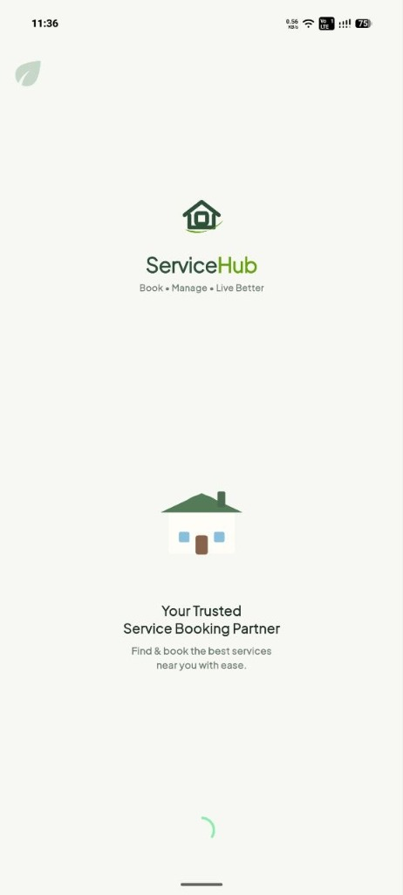
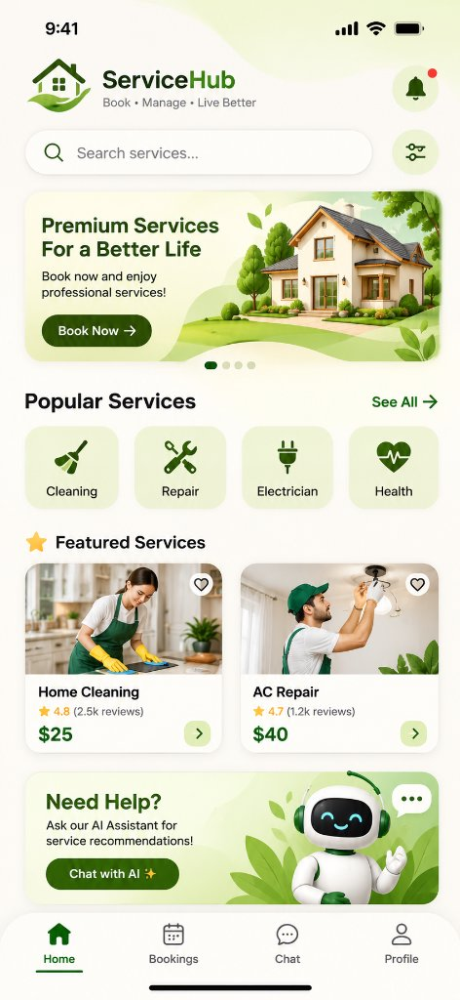
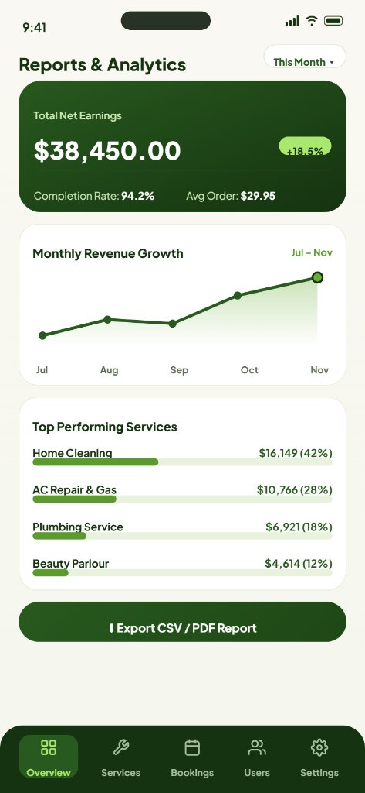
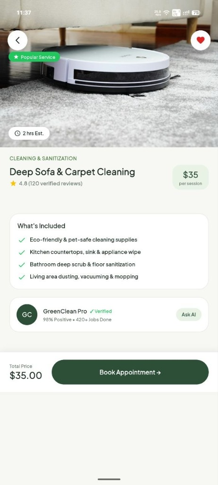
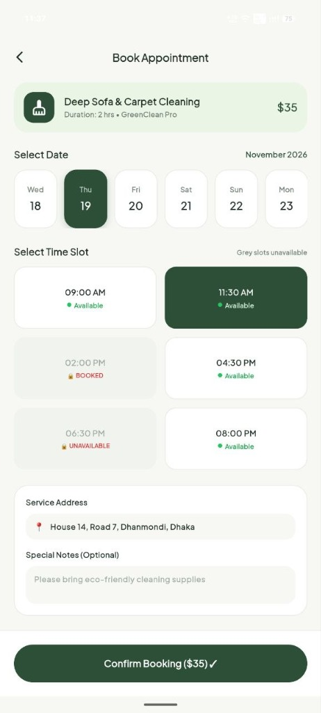
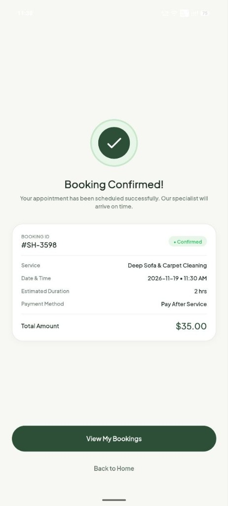
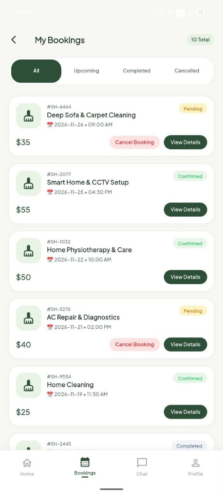
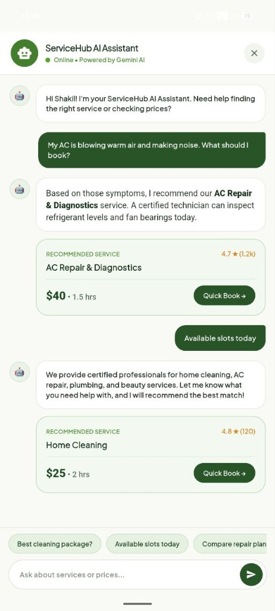
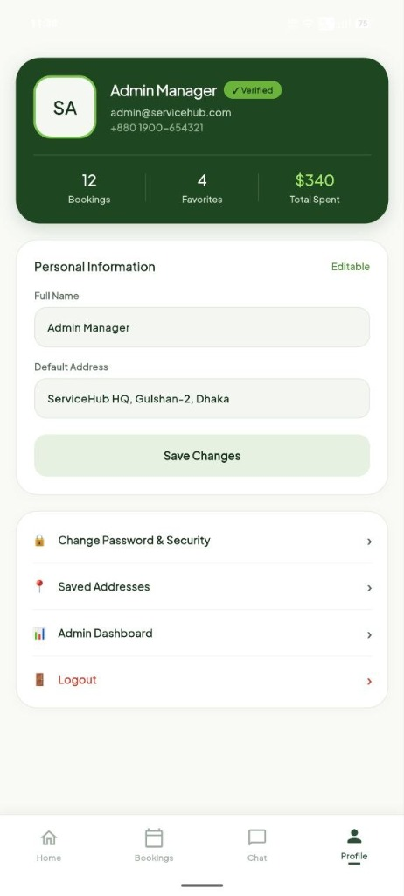
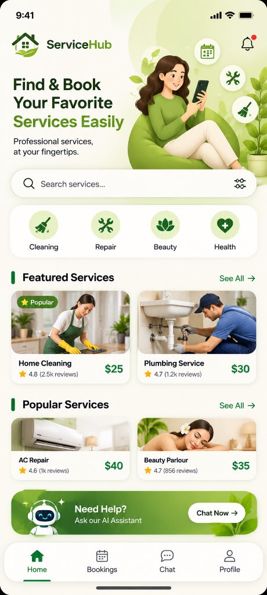

# 📱 ServiceHub Mobile Application (Flutter)

A modern, cross-platform mobile application developed with **Flutter & Dart**, featuring **Clean Architecture, Provider State Management, and REST API Integration**.

UI and UX designed to strictly match the **ServiceHub** design mockup.

---

## 📸 Application Screenshots Gallery

| 01. Splash Screen | 02. Home Screen | 03. Search & Filter | 04. Service Details |
| :---: | :---: | :---: | :---: |
|  |  |  |  |

| 05. Book Appointment | 06. Booking Confirmation | 07. My Bookings Lifecycle | 08. Gemini AI Assistant |
| :---: | :---: | :---: | :---: |
|  |  |  |  |

| 09. Admin Profile / Access | 10. Admin Analytics | 11. Admin Settings |
| :---: | :---: | :---: |
|  |  |  |

---

## 🌟 Key Features

1. **Authentication & Session:**
   - Registration (Full name, Email, Password) & Secure Login.
   - Form input validation & friendly error feedback.
   - Persistent authentication session (`shared_preferences`).
2. **Dynamic Home Screen:**
   - Promotional hero banner with direct booking CTA.
   - Horizontal popular services carousel ($25 Home Cleaning, $40 AC Repair, $30 Plumbing, $35 Beauty Parlour).
   - Category filtering (`Cleaning`, `Repair`, `Beauty`, `Health`, `Electric`).
   - Instant search with real-time text query and category chips.
3. **Service Details Screen:**
   - High-definition image header, rating, reviews count, and duration.
   - Quality guarantee badges (Experienced Staff, Eco-Friendly Products, 100% Satisfaction).
   - Fixed bottom action bar with "Book Now" and "Share".
4. **Interactive Appointment Booking:**
   - 14-day horizontal calendar date picker.
   - Live time-slot availability engine (`09:00 AM` to `04:00 PM`).
   - Conflict prevention preventing double-booking of reserved slots.
5. **Booking Lifecycle ("My Bookings"):**
   - Tabbed view separating **Upcoming** and **Past** appointments.
   - Status indicators: `Pending`, `Confirmed`, `Completed`, `Cancelled`.
   - Cancellation with reason recording for pending/confirmed appointments.
6. **User Profile:**
   - User profile ("Shakil Ahamed").
   - Profile updating (Name, Phone number) & Password change functionality.
7. **🤖 AI Service Assistant:**
   - Secure backend-mediated AI assistant (No API keys exposed in Flutter).
   - Context-grounded recommendations with interactive service preview cards directly in chat.

---

## 🚀 Setup & Execution Instructions

### 1. Prerequisites
- [Flutter SDK](https://flutter.dev) (>= 3.0.0)
- Android Studio / VS Code with Flutter Extension
- Android Emulator or physical Android device

### 2. Install Dependencies
```bash
flutter pub get
```

### 3. API Configuration
Open `lib/core/constants.dart`:
- For **Android Emulator**: `http://10.0.2.2:5000/api` *(Default)*
- For **Physical Device**: Replace with your PC local IP (e.g. `http://192.168.1.100:5000/api`)

### 4. Run the Application
```bash
flutter run
```

### 5. Build Android Release APK
To generate the APK for testing and submission:
```bash
flutter build apk --release
```
The output APK will be generated at:
`build/app/outputs/flutter-apk/app-release.apk`
